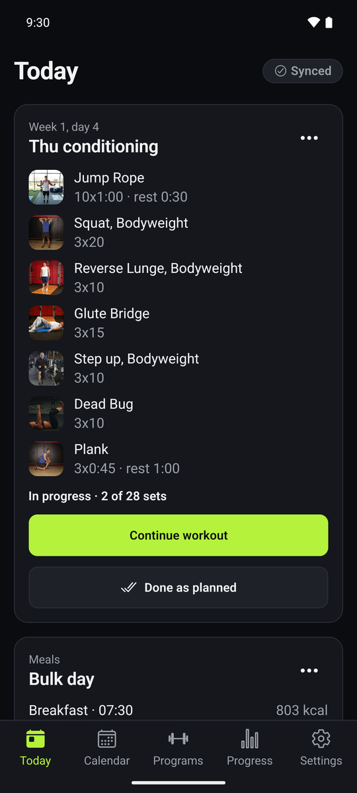
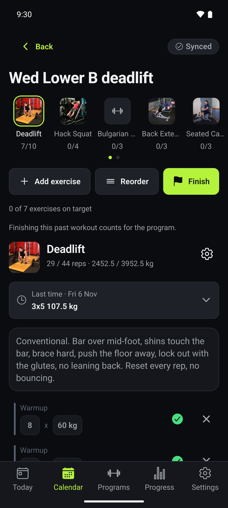
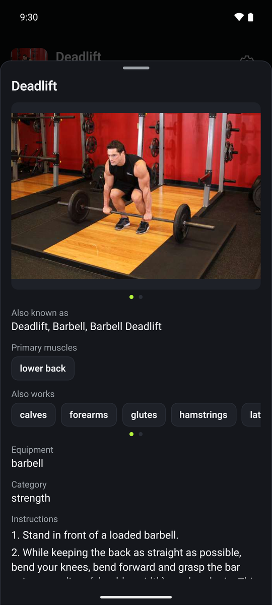
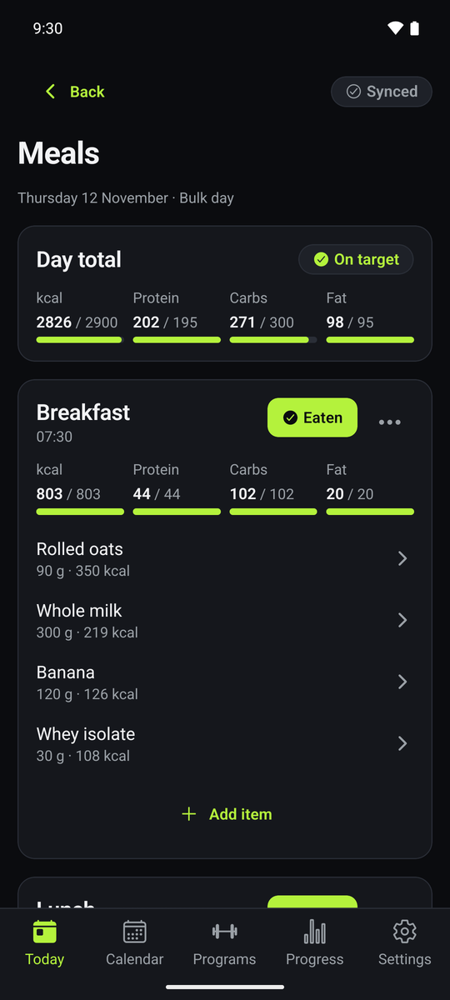
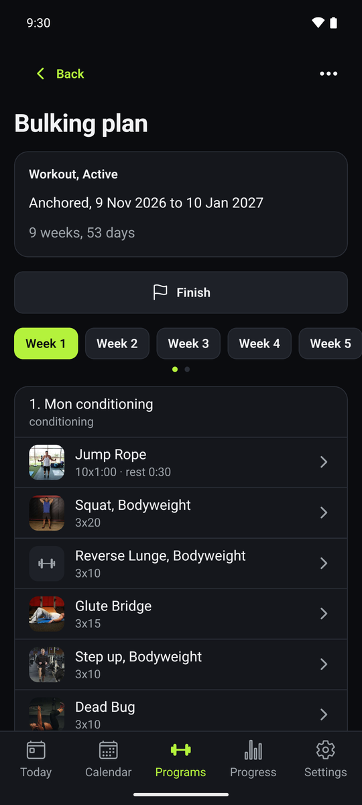
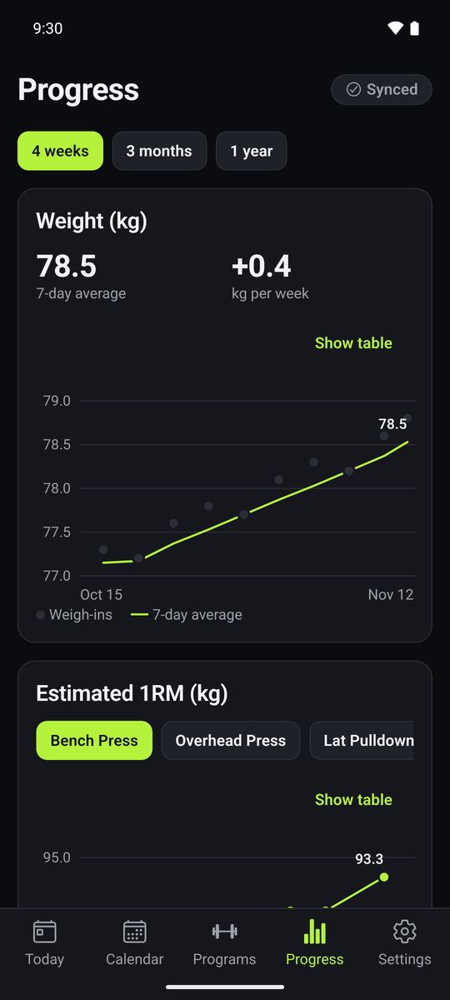
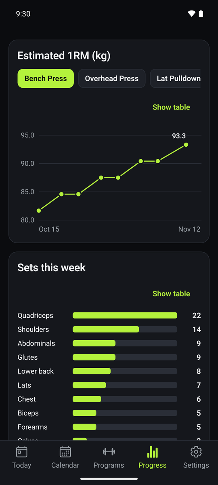
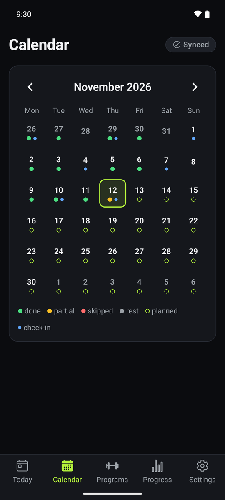

<div align="center">


# PlusUltra

**Self-hosted training and nutrition: programs as scripts, one Go binary, your own data**

[](https://github.com/gdsoumya/plusultra/actions/workflows/ci.yml)
[](https://github.com/gdsoumya/plusultra/actions/workflows/release.yml)
[](https://github.com/gdsoumya/plusultra/releases/latest)
[](https://hub.docker.com/r/gdsoumya/plusultra)
[](LICENSE)
[](https://github.com/gdsoumya/plusultra/releases/latest)

   

   

</div>

PlusUltra runs on your own server and keeps every workout, meal and check-in in your own Postgres.
Programs are Starlark scripts that the server resolves into daily workouts and meals, with
progression, alternates, supersets and warmups written as code instead of clicked through forms.
The Android app, the web app served by the server and any MCP client (Claude, Cursor, and so on)
talk to the same Connect RPC API, so an assistant can write your program, read your history and
log for you with the same rights you grant it.

## Features

- **Programs as code**: workout and meal programs are short Starlark scripts the server resolves
  into each day's plan; validate, simulate weeks ahead and activate them from the app or over MCP.
- **Workout logging**: tick sets as you go, edit reps and weight inline, switch alternates, add
  ad hoc exercises, and see what you did last time for every exercise. Rest and timed sets count
  down with a get-ready countdown, beeps and notifications; 1RM percentages round to your plates.
- **Nutrition**: meal plans and meal logs against a food catalog (USDA SR Legacy, IFCT 2017 staples,
  your own foods) with barcode lookup through Open Food Facts and per-item macro edits.
- **Check-ins and progress**: weight and photos, lift history, weight trend, adherence and a
  weekly summary, all from the same data an MCP client can query.
- **Exercise catalog**: muscles, equipment, instructions and images from free-exercise-db, plus
  custom exercises and per-exercise equipment settings.
- **Offline-first app**: the Android and web app keep a local store and sync in both directions;
  a workout logged without signal lands on the server later.
- **MCP built in**: every annotated RPC is a tool at `/mcp`, with `/llms.txt` and the reference
  pages so an assistant learns the program language on its own. API keys are scoped and revocable.
- **Yours to run**: one container plus Postgres, invite-only registration by default, per-user
  export of everything as a zip, no telemetry and no accounts anywhere else.

## Get the app

- **Android**: download the APK from the [latest release](https://github.com/gdsoumya/plusultra/releases/latest)
  and sideload it. Enter your server address on first start.
- **Web**: the server serves the same app at its root URL, so a browser on any device works too.
- **MCP**: add `PUBLIC_URL/mcp` to Claude or Cursor with an API key (see API keys and MCP).

## Deploy

Requirements: Docker with Compose, or Portainer. The stack is `docker-compose.yaml`: the published
image `gdsoumya/plusultra` and a Postgres 17 container, with everything they store under one host
directory, `DATA_ROOT`.

Portainer: add a stack, paste `docker-compose.yaml`, set the environment variables (at least
`POSTGRES_PASSWORD`; usually `PUBLIC_URL`, `DATA_ROOT` and `REGISTRATION` too) and deploy. With
plain Compose, copy `.env.example` to `.env` next to the file and fill it in:

```sh
cp .env.example .env   # set POSTGRES_PASSWORD, PUBLIC_URL, DATA_ROOT
docker compose up -d
curl http://localhost:8080/healthz
```

The first start migrates the database and seeds the exercise and food catalog from the image (see
Catalog). Open `http://localhost:8080` for the web app; the first account to register becomes the
admin. The server listens on plain HTTP: put your reverse proxy (Caddy, nginx, Tailscale serve) in
front of it for TLS. Nothing else needs fronting: the one container hosts the UI, the RPCs
(`/api/v1`), the MCP endpoint (`/mcp`) and the docs (`/llms.txt`).

Environment variables, read by `docker compose` from the shell, an `.env` file or the Portainer
stack (`.env.example` lists them all):

| Variable | Default | Meaning |
|---|---|---|
| `POSTGRES_PASSWORD` | empty | Postgres password, shared with the server's `DATABASE_URL`. Required; set it before the first start, it cannot be changed through compose later. |
| `DATA_ROOT` | `./data` | Host directory for `.postgres/` (the database) and `exercises/` (catalog images). |
| `PUID` / `PGID` | `0` | Owner of `DATA_ROOT/exercises`. Root can always write there; set your own ids when `DATA_ROOT` belongs to you. |
| `LISTEN_PORT` | `8080` | Host port the server is published on. |
| `PUBLIC_URL` | empty | Address clients use. Renders absolute links in `/llms.txt` and the MCP instructions. An `http://` value drops the `Secure` cookie flag for local use; empty keeps it. |
| `REGISTRATION` | `invite` | `invite` or `open`. In invite mode every account after the first needs an invite code. |
| `ALLOWED_ORIGINS` | empty | Comma-separated browser origins, besides `PUBLIC_URL`'s, allowed to call the API with cookies. The hosted web app needs none; set it for the Expo dev server (`http://localhost:8081`) or a web build served elsewhere. No wildcards. |
| `SEED_CATALOG` | `auto` | `auto` applies the catalog shipped in the image when its version is new (see Catalog); `off` never touches it. |
| `PLUSULTRA_IMAGE` | `gdsoumya/plusultra:latest` | Image to run; a tag pins a version. |
| `POSTGRES_SHARED_BUFFERS` | `256MB` | Postgres `shared_buffers`, modest for a NAS. |
| `DATABASE_URL` | the stack's Postgres | Full Postgres URL when the database lives elsewhere. |

The server itself reads `DATABASE_URL`, `LISTEN` (`:8080`), `REGISTRATION`, `PUBLIC_URL`,
`ALLOWED_ORIGINS`, `IMAGES_DIR` (`/data/exercises`) and `SEED_CATALOG`. Every RPC lives
under `/api/v1` (`/api/v1/plusultra.v1.AuthService/Login`), as do the exercise images; the app
appends the prefix to the server address you enter. Browsers on `PUBLIC_URL`'s origin and on
`ALLOWED_ORIGINS` may call the RPCs with credentials; `/llms.txt`, the reference pages and exercise
images are readable from any origin; `/mcp` has no CORS.
There is no session secret: sessions are random tokens stored hashed in the database.

## First user and invites

The first account registers without an invite and becomes the admin. Register from the app, or
over the API:

```sh
curl -X POST http://localhost:8080/api/v1/plusultra.v1.AuthService/Register \
  -H 'Content-Type: application/json' \
  -d '{"username":"alice","password":"a long passphrase"}'
```

Every later account needs an invite code in invite mode. Admins create codes in the app
(Settings) or from the command line, which prints a single-use code valid for seven days:

```sh
docker compose exec server /plusultra invite
docker compose exec server /plusultra invite -expires-in 48h
```

The same command recovers access when no admin can log in, since it needs only the database.

## API keys and MCP

Scripts and MCP clients authenticate with API keys instead of sessions. Create one in the app or
over the API with a session token:

```sh
curl -X POST http://localhost:8080/api/v1/plusultra.v1.ApiKeyService/CreateApiKey \
  -H "Authorization: Bearer $TOKEN" -H 'Content-Type: application/json' \
  -d '{"name":"claude","scopes":["API_KEY_SCOPE_READ","API_KEY_SCOPE_WRITE"],"expiresAt":"2027-01-01T00:00:00Z"}'
```

The response holds the key once, prefixed `lsk_`. Scopes are `READ`, `WRITE` and `ADMIN`
(users and invites).

The MCP endpoint is `POST $PUBLIC_URL/mcp` (streamable HTTP, stateless) with
`Authorization: Bearer lsk_...`. Every annotated RPC is a tool: programs, calendar, workouts,
meals, check-ins, catalogs, insights and the reference docs. The reference tools and
`$PUBLIC_URL/llms.txt` work without a key. For Claude Desktop or Claude Code add the server as a
remote MCP server with that URL and header.

## Catalog

The image ships the exercise and food catalogs under `/seed` and `serve` loads them on first
start: the curated exercise list enriched from free-exercise-db (muscles, instructions, images
copied into the `/data` volume), USDA SR Legacy foods, the bundled IFCT seed of Indian staples and
the food concepts that group the same food across sources. Nothing to run by hand: a Portainer
stack with `docker-compose.yaml` and the environment values above is all a NAS needs.

The seed is versioned like a migration. `/seed/VERSION` derives from the dataset checksums and an
importer format number; the server stores the version it applied and, when a new image carries a
different one, upserts the whole catalog again before listening (exercises by slug, foods by source
and source id). Your own rows are never touched: custom foods and exercises, exercise data,
equipment, logged meals and programs stay as they are. A reseed takes well under a minute.
`SEED_CATALOG=off` never touches the catalog: set it for a build without `/seed` or to manage the
catalog by hand.

Manual imports still work, to add a dataset the image does not carry or to re-import one. They
run through the same image with a bind mount for the source files:

```sh
docker compose exec server /plusultra seed-catalog                     # what serve does on start
docker compose run --rm -v /path/to/free-exercise-db:/import server import-exercises /import
docker compose run --rm -v /path/to/foods:/import server import-foods usda /import/FoodData_Central_csv.zip
docker compose run --rm -v /path/to/foods:/import server import-foods indb /import/indb.csv
docker compose exec server /plusultra import-foods ifct       # bundled IFCT seed
docker compose exec server /plusultra import-foods concepts   # bundled food concepts
```

Re-running an import is idempotent. Every food import reassigns food concepts afterwards so new
rows join their groups.

Datasets and licences. Building the image downloads them, so `docker build` needs network access;
the `Dockerfile` pins each file by URL and SHA-256.

- [free-exercise-db](https://github.com/yuhonas/free-exercise-db), Unlicense (public domain).
  Images are re-encoded to at most 640 px, JPEG quality 60, to keep the image small.
- [USDA FoodData Central, SR Legacy (April 2018)](https://fdc.nal.usda.gov/download-datasets), public domain (CC0).
- IFCT 2017 staples (Longvah et al., Indian Food Composition Tables, NIN/ICMR 2017), a small
  hand-transcribed seed of nutrient values embedded in the binary.
- [INDB](https://github.com/lindsayjaacks/Indian-Nutrient-Databank-INDB-) (Indian recipes) is not
  shipped: the repository publishes no licence and only xlsx. Export its `INDB.xlsx` to CSV and run
  `import-foods indb` to add it.

## Backups

Everything is under `DATA_ROOT`: `.postgres/` holds the database and `exercises/` the catalog
images, which a reseed recreates. Keep the same Postgres image flavour for the life of `.postgres/`:
moving an existing database between `postgres:17` (glibc) and `postgres:17-alpine` (musl) changes
the text collation and silently corrupts its indexes, so unique lookups miss rows until you
`REINDEX DATABASE plusultra`. Dump the database rather than copying its files:

```sh
docker compose exec postgres pg_dump -U plusultra plusultra | gzip > plusultra.sql.gz
```

Each user can also download everything they own as a zip through `ExportService/ExportAll`, which
the app offers in Settings.

## Upgrading

```sh
docker compose pull && docker compose up -d
```

Or pin a tag through `PLUSULTRA_IMAGE` and redeploy the stack. The new server applies pending
migrations on start, reseeds the catalog when the image carries a new version of it, and
re-resolves every active program once so upcoming days pick up engine changes. Take a backup
first; migrations are forward only. From a source checkout, `docker compose up -d --build` builds
the image instead (the committed `docker-compose.override.yaml` adds the build and a Postgres host
port for development; a deployment uses `docker-compose.yaml` alone).

## Development

CI (`.github/workflows/ci.yml`) runs the Go lint and tests against Postgres, the app's typecheck,
lint and Jest suite, and a Docker build on every push and pull request. Pushing a `vX.Y.Z` tag runs
the release workflow: it publishes `gdsoumya/plusultra:X.Y.Z` and `:latest` for amd64 and arm64,
builds the signed Android APK (`docs/dev/release-android.md`) and creates the GitHub release with
the APK attached.

See `CLAUDE.md` for the make targets. `make db-up` starts Postgres for tests, `make check` runs
lint and tests, `make web` exports the web app into `internal/web/dist` for `make build` to embed
(without it the binary serves a placeholder page), `make e2e` builds the stack and drives it end
to end, `make docker` tags `gdsoumya/plusultra:latest` and `:<commit>`, `make docker-multiarch`
builds them for amd64 and arm64 (`PUSH=1` publishes). `make generate` and
`make web` need Node 22 or newer. Buf fetches the proto dependencies from the BSR, which rate-limits anonymous
clients; set `BUF_TOKEN` if the retries are not enough.

## Contributing

See [CONTRIBUTING.md](CONTRIBUTING.md) for the setup and the checks to run before a pull request,
and [SECURITY.md](SECURITY.md) for reporting a vulnerability.

## License

[PolyForm Noncommercial 1.0.0](LICENSE): free for personal and other noncommercial use, including
running it for yourself, your family or a club at no charge; commercial use, resale and commercial
services built on it are not permitted. The bundled datasets keep their own licences, listed above.
